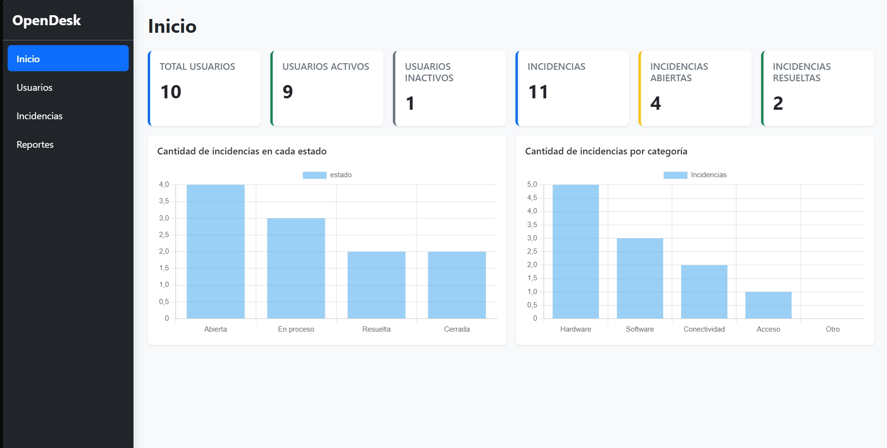
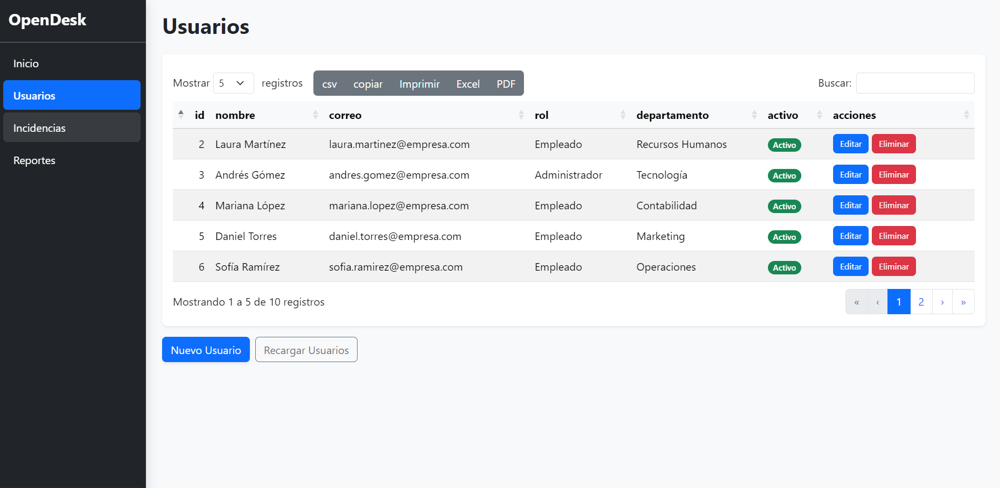
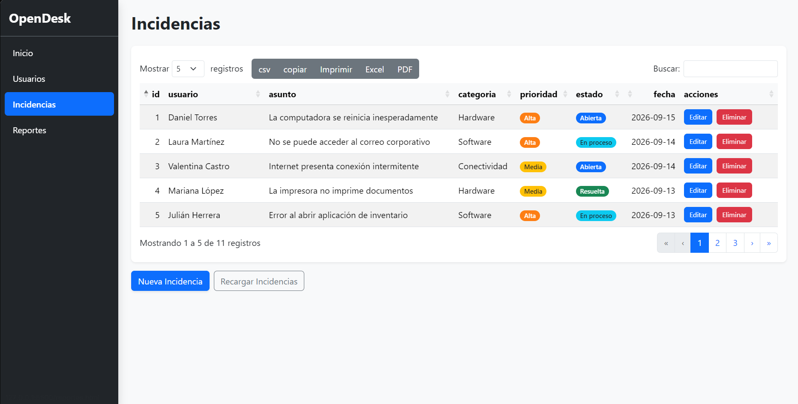
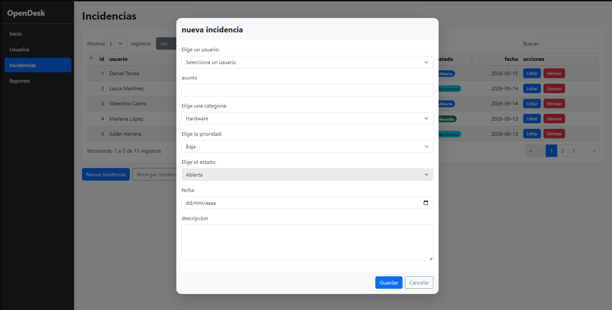
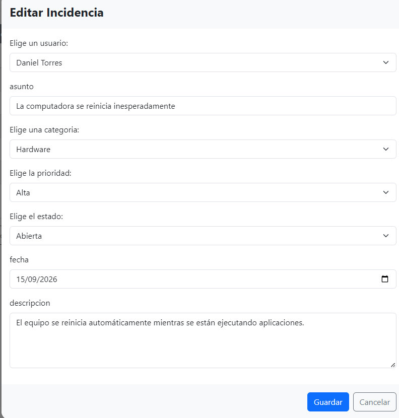
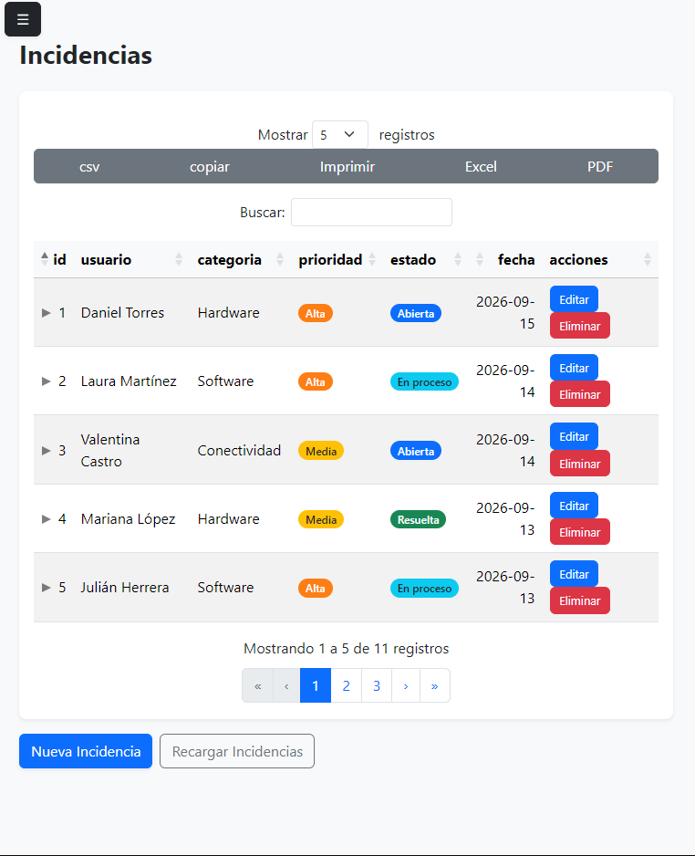

# OpenDesk

## 1. Descripción

Sistema de gestión de incidencias con usuarios, hecho en HTML/CSS/JS vanilla, sin backend.

## 2. Capturas de pantalla

Dashboard



Tabla de usuarios



Tabla de incidencias



Modal de crear/editar




Vista responsive en celular



## 3. Funcionalidades

- CRUD de usuarios
- CRUD de incidencias
- Dashboard con indicadores y gráficos
- Reportes exportables (CSV/Excel/PDF/imprimir)
- Persistencia local
- Validación de formularios
- Modo responsive para tablet y celular
- Restauración de datos iniciales

## 4. Tecnologías usadas

| Tecnología                        | Versión  | Para qué                                              |
| --------------------------------- | -------- | ----------------------------------------------------- |
| Bootstrap                         | 5.3.8    | Interfaz, navegación, formularios, estructura visual  |
| jQuery                            | 3.7.1    | Dependencia de DataTables                             |
| DataTables (+Buttons, Responsive) | 3.1.2    | Tablas: búsqueda, paginación, exportación, responsive |
| JSZip                             | 3.10.2   | Soporte interno para exportar a Excel                 |
| pdfmake                           | 0.2.21   | Soporte interno para exportar a PDF / imprimir        |
| Chart.js                          | 4.5.0    | Gráficos del dashboard                                |
| JustValidate                      | 4.3.0    | Validación de formularios                             |
| SweetAlert2                       | 11.26.25 | Alertas y confirmaciones                              |
| localForage                       | 1.10.0   | Persistencia local (IndexedDB)                        |

Detalle completo de licencias, instalación y evaluación en [`docs/DEPENDENCIAS.md`](docs/DEPENDENCIAS.md).

## 5. Cómo ejecutarlo

1. Clonar el repositorio.
2. Abrir la carpeta con Live Server (o un servidor HTTP local equivalente, como Laragon). **No funciona abriendo con `file://`**, porque la carga de datos usa XHR/fetch, que los navegadores bloquean sobre el protocolo de archivo local.
3. Abrir `index.html` desde el servidor local.

## 6. Estructura del proyecto

```
js/
data/
vendor/
docs/
pruebas_graficos/
css/
incidencias.html
index.html
README.md
reportes.html
usuarios.html
```

## 7. Decisiones técnicas destacadas

- **Chart.js sobre Apache ECharts:** se evaluaron ambas librerías construyendo el mismo gráfico con cada una. Chart.js resultó más liviana (204 KB frente a 984 KB de ECharts), con menor tiempo de integración y documentación más directa para este caso de uso puntual. ECharts ofrece mejor soporte de accesibilidad (ARIA) de fábrica, pero ese beneficio no compensó el mayor peso y tiempo de aprendizaje para el alcance de este proyecto.
- **jQuery 3.7.1 en vez de 4.0.0:** se descartó la versión 4.0.0 (la más reciente) porque elimina métodos antiguos que el ecosistema de DataTables (Buttons, Responsive) podría seguir usando internamente, sin confirmación oficial de compatibilidad plena. Se optó por la serie 3.x, mejor probada junto a DataTables.
- **Los ids de usuarios e incidencias no se reordenan al eliminar un registro:** esto es una decisión de diseño, no un error. El `id` es un identificador único y permanente, no una posición visual. Las incidencias guardan una referencia (`usuarioId`) al id del usuario que las reportó; si los ids se reordenaran tras un borrado, esas referencias quedarían apuntando a un usuario equivocado o inexistente. Por eso los nuevos ids se generan con `mayorId + 1` en vez de `longitud del arreglo + 1`: así nunca se reutiliza un id aunque existan huecos.

## 8. Reglas y restricciones del proyecto

- Solo HTML, CSS, JavaScript y JSON. Sin React, Vue, Angular, PHP, bases de datos ni backend.
- Librerías instaladas por npm o desde fuentes oficiales, ubicadas en `vendor/`, separadas del código propio.
- Sin CDN en la entrega final: el proyecto debe funcionar sin conexión a internet.
- No se modifican archivos minificados ni internos de las librerías.
- Pruebas realizadas con servidor HTTP local (Live Server), nunca abriendo con `file://`.
- No se usan componentes comerciales/Premium ni DataTables Editor.
- Probado en 360px, 768px y 1440px de ancho.
- Accesibilidad: etiquetas visibles en los formularios, información que no depende solo del color (ver insignias de estado/prioridad).

## 9. Autor

Johan Sammir Arango Escobar / [LinkedIn](https://linkedin.com/in/johan-samir-arango-escobar-184a2a38b) / [GitHub](https://github.com/arangoescobarjohansammir-art)
